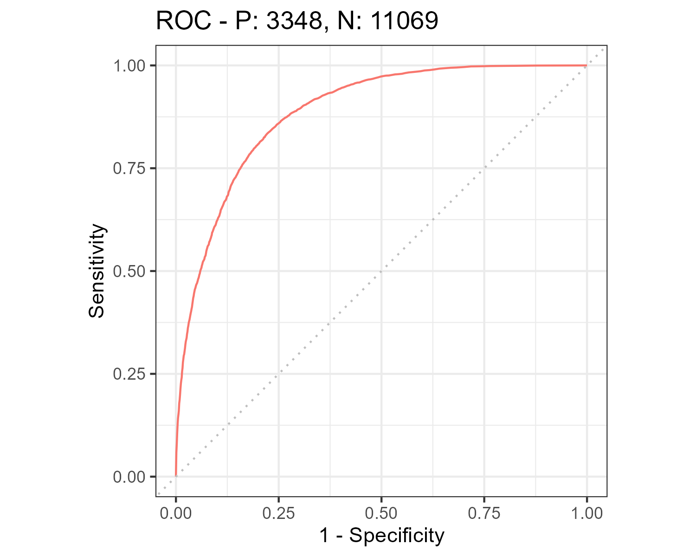
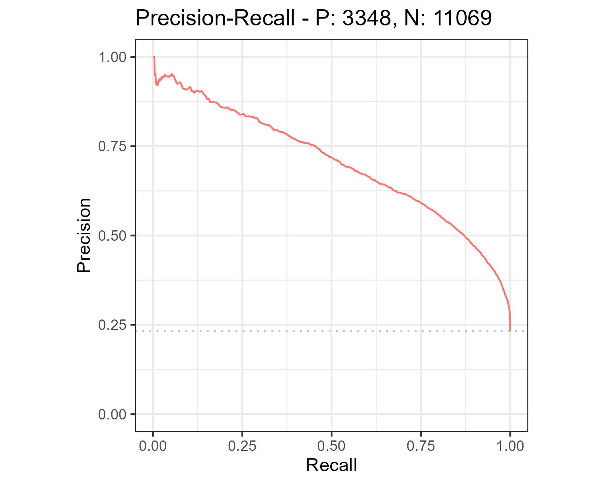

# m6APrediction

**Predict m6A RNA modification sites from sequence and genomic features.**

`m6APrediction` packages a trained random forest classifier for
N6-methyladenosine (m6A) sites together with the feature-encoding helpers used
to train it. Given a table of candidate adenosines described by seven sequence
and genomic features, it returns a per-site probability and a
Positive / Negative call at a user-chosen threshold.

## Why this tool

m6A is the most abundant internal modification of eukaryotic mRNA and is
involved in splicing, stability, translation and decay. Experimental mapping
(MeRIP-Seq, miCLIP) is expensive and antibody-dependent, so a sequence-based
predictor is useful for prioritising candidate sites before validation.
`m6APrediction` exposes the model as a small, documented and installable R
package, so the same prediction can be reproduced in a script.

## Installation

```r
if (!requireNamespace("devtools", quietly = TRUE)) {
  install.packages("devtools")
}
devtools::install_github("MaxRuan05/m6APrediction")
```

`randomForest` is installed automatically as a dependency. R >= 3.5.0 is
required (the bundled model uses RDS format version 3).

## Quick start

```r
library(m6APrediction)

## 1. Batch prediction from a feature table
ml_fit <- readRDS(system.file("extdata", "rf_fit.rds",
                              package = "m6APrediction", mustWork = TRUE))
example_df <- read.csv(system.file("extdata", "m6A_input_example.csv",
                                   package = "m6APrediction", mustWork = TRUE))

result <- prediction_multiple(ml_fit, example_df, positive_threshold = 0.6)
head(result[, c("predicted_m6A_prob", "predicted_m6A_status")])

## 2. Single-site prediction
prediction_single(ml_fit,
                  gc_content = 0.6, RNA_type = "mRNA", RNA_region = "CDS",
                  exon_length = 12, distance_to_junction = 5,
                  evolutionary_conservation = 0.8, DNA_5mer = "GGACA",
                  positive_threshold = 0.5)
```

### Input format

| Column | Meaning |
|---|---|
| `gc_content` | GC content of the surrounding window, 0-1 |
| `RNA_type` | `mRNA`, `lincRNA`, `lncRNA` or `pseudogene` |
| `RNA_region` | `CDS`, `intron`, `3'UTR` or `5'UTR` |
| `exon_length` | exon length, **already log2-transformed** |
| `distance_to_junction` | distance to the nearest splice junction, **already log2-transformed** |
| `evolutionary_conservation` | conservation score, 0-1 |
| `DNA_5mer` | five nucleotides with the candidate A in the centre |

## Model performance

Evaluated on a held-out test set of 14,417 sites (10,069 negatives and 3,348
positives). The ROC curve summarises discrimination across all thresholds; the
precision-recall curve is more informative here because positive sites are the
minority class.





AUROC = 0.887, AUPRC = 0.704. The positive prevalence is 0.232, so a random
classifier would reach an AUPRC of about 0.232; the gap between 0.704 and that
baseline indicates that the model learns sequence signal rather than the
majority class.

## Documentation

```r
?prediction_multiple   # batch prediction
?prediction_single     # single-site prediction
```

`dna_encoding()` is an internal helper and is documented but not exported.

## License

MIT (c) 2026 Zhicheng Ruan
